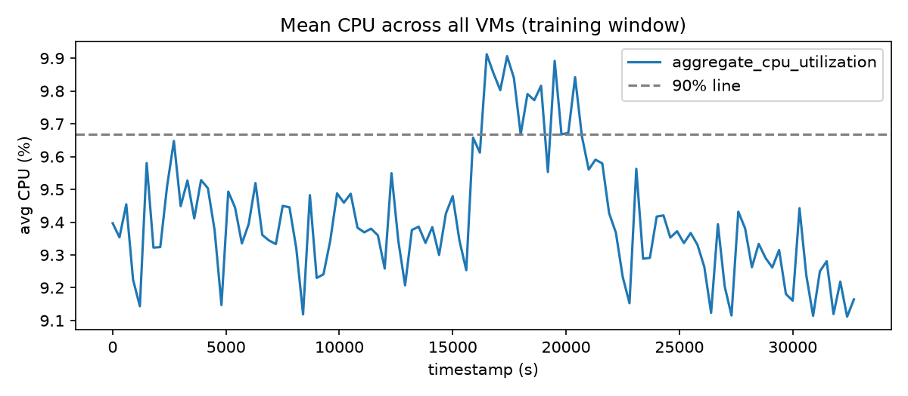
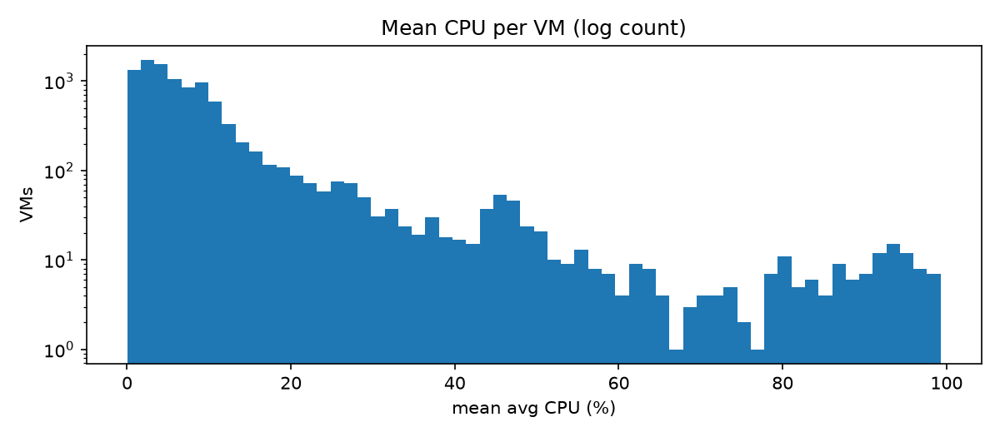
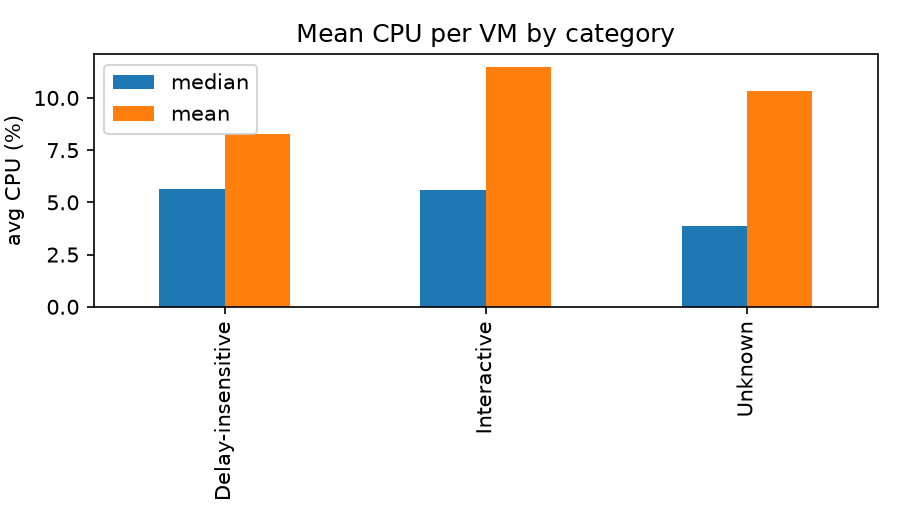

# Forecasting Aggregate CPU Demand on an Azure VM Trace

## 1. Executive summary

- **Question.** How predictable is the aggregate workload of 10,000 Azure VMs, how accurately can the next two hours be forecast, and what should an infrastructure team do with the forecast?
- **Data.** 10,000 VMs with 134 five-minute readings each (about 11.1 hours). All VMs share the same 134 timestamps and none is created or deleted inside the window.
- **Targets.** `active_vm_count` is constant at 10,000, so it is forecast by persistence. The interesting target is `aggregate_cpu_utilization`, which sits near 9.4% and moves by less than one percentage point.
- **Model.** An AR(1) model chosen by rolling-origin validation inside the training window. On the final 24 steps it reached MAE 0.129 and RMSE 0.166, against 0.147 and 0.185 for persistence (relative MAE 0.88). In validation the gain was smaller (0.173 vs 0.189, about 8%).
- **Recommendation.** Reserve capacity equal to the forecast plus a margin taken from validation errors (0.15 CPU points at the 99% level, about 1.6% extra capacity). On the holdout this margin covered 71% of steps, so it is a cheap buffer rather than a guarantee.
- **Main caveats.** Eleven hours of data cannot show daily patterns; VM churn is zero by construction of the release; and too few high-load moments fall in the validation windows to measure peak accuracy.

## 2. Data understanding and preprocessing

Two files were used: `vm_cpu_readings.csv.gz` (1,340,000 rows: `timestamp`, `vm_id`, `min_cpu`, `max_cpu`, `avg_cpu`) and `vm_metadata.csv.gz` (10,000 rows, one per VM). The release checksums match `SHA256SUMS`.

Checks on the readings:

| Check | Result |
|---|---|
| Cadence | Every gap between timestamps is exactly 300 s (133 gaps) |
| Coverage | 134 distinct timestamps; 10,000 VMs report at every one |
| Missing values | None in any column |
| Duplicate (VM, timestamp) pairs | None |
| Value range | All CPU values between 0 and 100; min ≤ avg ≤ max in every row |

Nothing needed repairing. The pipeline still drops missing readings (it does not fill them) and counts each VM once per timestamp, so it behaves correctly on data with gaps.

**Lifetimes and churn.** Every VM has `timestamp_vm_created = 0`. The earliest deletion is at 40,500 s, after the last observation (39,900 s). Most VMs show a deletion time of 2,591,400 s, the end of the 30-day source trace, meaning they were still running when recording stopped. The release kept only VMs with complete 134-reading traces, so no VM joins or leaves inside the window. This explains why `active_vm_count` is flat. It is a property of how the data was selected and says nothing about real-world churn.

**Targets.** For each timestamp, `active_vm_count` is the number of distinct VMs with a valid reading, and `aggregate_cpu_utilization` is the mean of VM-level `avg_cpu`. The full target series was built first; the first 110 points are the training window and the last 24 (2 hours) the holdout.

**Leakage control.** All analysis, model choice and margin estimation below use the training window only. The holdout is scored once, after the model is fixed. The metadata columns `avg_cpu`, `max_cpu` and `p95_max_cpu` are statistics over the full 30-day trace, which includes the holdout hours, so they are not used as features.

## 3. Workload analysis

All figures in this section use the training window.



**The aggregate is calm.** Mean CPU is 9.41% with a standard deviation of 0.19. The highest point is 9.91% (second 16,500, about 4.6 hours in) and the lowest 9.11% (second 32,400). A slow rise between roughly 15,900 s and 21,000 s lifts the series above its 90% line (9.67%), then it drifts back down. Operationally, the total demand is stable and mostly idle; short random movement of a few hundredths of a point dominates.

**The calm total hides a very uneven population.** Averaging 10,000 VMs cancels individual ups and downs, so single VMs with 0% to 99% CPU still produce a nearly flat total.



| Statistic (per-VM mean CPU) | Value |
|---|---|
| Median | 5.5% |
| 90th percentile | 19.7% |
| 95th percentile | 33.6% |
| 99th percentile | 79.6% |
| Share of VMs under 5% | 46.4% |

Nearly half the VMs are close to idle, while a thin tail, including a small cluster near 80–95%, carries much of the load. Capacity is therefore driven by a small group of heavy VMs, and the large idle group is a cost-saving opportunity.

**Segments.** Most VMs are small: 7,534 of 10,000 have 2 cores and only 72 have 24 or more.



| Category | VMs | Mean | Median |
|---|---|---|---|
| Delay-insensitive | 6,180 | 8.3% | 5.6% |
| Interactive | 3,091 | 11.5% | 5.6% |
| Unknown | 729 | 10.4% | 3.9% |

Medians are similar, but Interactive has the highest mean because it has more heavy VMs. Every category contains both near-idle and near-saturated VMs, so category alone does not identify the heavy ones.

**Temporal patterns.** Eleven hours is too short to estimate a daily cycle, so none is claimed. For the same reason a seasonal-naive baseline was not used.

## 4. Forecasting approach

- **`active_vm_count`:** constant at 10,000 in training, so the forecast repeats the last value.
- **`aggregate_cpu_utilization`:** candidates were persistence and ridge-regularised autoregressive models AR(p) with p = 1, 2, 3, fitted on the training series and forecast recursively over 24 steps. During exploration, a moving average (window 6) and simple exponential smoothing (several smoothing levels) were also tried.
- **Features and information.** Each forecast uses only values observed up to the forecast origin. No calendar features are used because the window is too short to support them.
- **Mapping to the required cadence.** The model works directly at the five-minute cadence, so no resampling or mapping back is needed.
- **Final model.** The candidate with the lowest mean validation MAE is refitted on all 110 training points and forecasts the 24 holdout steps. Predictions are clipped to [0, 100].

The whole pipeline is one command, `python -m cwfc.predict --data challenge_data --output predictions.csv`.

## 5. Validation methodology

Validation is rolling-origin (expanding window) inside the first 110 points. Five origins were used (after 62, 68, 74, 80 and 86 observations), each forecasting the next 24 steps, so every validation window ends inside the training data. This mirrors production, where a forecast is issued repeatedly from the latest history and scored against the next two hours. Data is never shuffled.

The windows overlap, and there are only five of them, so the validation score is a noisy estimate. Model settings (p, smoothing level) were chosen from this score alone.

## 6. Results versus baseline

Rolling-origin validation (mean MAE over five origins, CPU percentage points):

| Method | MAE |
|---|---|
| AR(1) | **0.173** |
| Persistence (baseline) | 0.189 |
| SES, best setting (alpha 0.9) | 0.190 |
| AR(2) | 0.204 |
| AR(3) | 0.223 |
| Moving average (window 6) | 0.237 |

Persistence is the strongest simple baseline. Larger AR orders get worse, which is consistent with overfitting on about 100 points. Validation relative MAE of AR(1) against persistence is 0.918 (RMSE 0.913).

Final holdout (24 steps, scored once after the model was fixed):

| | MAE | RMSE |
|---|---|---|
| AR(1) | **0.129** | **0.166** |
| Persistence | 0.147 | 0.185 |

Relative MAE is 0.879 (12% lower than persistence) and relative RMSE 0.90. The holdout error is lower than the validation error, which most likely reflects that the holdout window is calmer, not that the model improved. The validation figure is the more conservative one, and the gain over the baseline is real but modest. With a mean level of 9.4%, a holdout MAE of 0.129 is about 1.4% of the level.

## 7. Error and failure analysis

**Error grows with the horizon.** In validation, mean absolute error for AR(1) rises from 0.08 at 5 minutes ahead to 0.16 at 30 minutes, 0.20 at one hour, 0.26 at 90 minutes and 0.27 at two hours, about three times larger.

**Bias changes sign.** In validation both methods over-forecast (mean error of actual minus forecast: −0.14 for AR(1), −0.16 for persistence), because the training series falls after its mid-window rise and the models anchor on recent higher values. On the holdout the sign flips to +0.08: the real level rises over the final hour while the AR(1) forecast stays almost flat (9.17 rising slowly to 9.20). A model that mean-reverts cannot follow a late drift it has no evidence for.

**Largest miss.** At second 37,500 the real value jumped to 9.64 while the forecast was 9.19 (error 0.44). Nothing in the earlier data signals a jump like this; it is a short spike inside noise of about 0.1.

**Peak periods.** Only 6 of the 120 validation steps lie above the 90% line (and, because the windows overlap, probably represent only two or three distinct moments). Performance in high-load periods therefore could not be measured reliably; the validation numbers (0.081 for persistence, 0.084 for AR(1) at high load) should not be read as a finding.

**Metric notes.** MAE and RMSE are reported, plus relative error against persistence. No percentage metric is used, so near-zero denominators are not an issue.

## 8. Capacity-planning recommendation

**Policy.** Reserve capacity for each future five-minute step as `forecast + margin`, where the margin is a quantile of past under-forecast errors (actual minus forecast, floored at zero) from the validation rounds. Refresh the forecast and the margin as new data arrives.

| Quantile | Margin (CPU points) | Holdout steps covered | Extra capacity vs forecast |
|---|---|---|---|
| 0.5 / 0.8 | 0.000 | 21% | 0% |
| 0.9 | 0.072 | 58% | 0.8% |
| 0.95 | 0.113 | 67% | 1.2% |
| 0.99 | 0.149 | 71% | 1.6% |

"Covered" is the share of the 24 holdout steps where the plan was at least the real value. The margin was chosen from training data only.

**Recommended setting: the 0.99 quantile.** The extra cost is small, because the total moves little, while a shortage hurts users, especially on Interactive VMs. The choice follows from this cost argument, not from the holdout score.

**The trade-off.** A larger margin reduces under-provisioning (slow or failing services) and increases over-provisioning (paying for unused capacity). As an illustration only: for a compute bill of $100,000 per month sized to planned demand, 1.6% extra capacity is about $1,600 per month, against about $800 at the 0.9 level. Actual cost depends on pricing and how capacity is bought.

**Why the margin is not a guarantee.** The margin comes from five overlapping validation windows in which the model over-forecast, so low quantiles produced a zero margin. On the holdout the model under-forecast, and even the 0.99 margin covered only 71% of steps. The error direction differs between windows, so the margin should be re-estimated regularly.

**Suggested complementary rules (not tested here).**
- Peak-risk trigger: if real usage exceeds the plan in two consecutive steps, re-run the forecast and raise the quantile one level.
- Segment rule: give the Interactive category priority for headroom.
- Right-sizing: about 46% of VMs average under 5% CPU; reducing or consolidating them would likely save far more than the safety margin costs.

## 9. Limitations and future work

- **Short history.** 134 timestamps (about 11 hours) cannot support daily or weekly seasonality, long-horizon claims or calendar features.
- **Selected population.** Only VMs with complete traces were kept, so churn is zero and the count target is trivial. Results do not describe a live cloud with VMs arriving and leaving.
- **Few validation windows.** Five overlapping windows give noisy model and margin estimates, and almost no high-load moments, so peak behaviour is unmeasured.
- **Single holdout.** One 24-step window cannot establish how much better AR(1) is than persistence; the validation gain (about 8%) is the safer claim.
- **Margin transfer.** The margin did not carry over to the holdout, as discussed above.
- **Future work.** Per-category forecasts, a margin that widens with the forecast horizon, prediction intervals, longer traces from the full Azure dataset to test seasonality and churn, and anomaly detection for spikes such as the one at second 37,500.

## Reproducibility

```bash
python -m pip install -e ".[dev,analysis]"
python -m cwfc.predict --data challenge_data --output predictions.csv
python -m cwfc.capacity --data challenge_data
python analysis/eda.py --data challenge_data
python -m pytest -q
```

Source data: Microsoft Azure Public Dataset V2, <https://github.com/Azure/AzurePublicDataset>.
